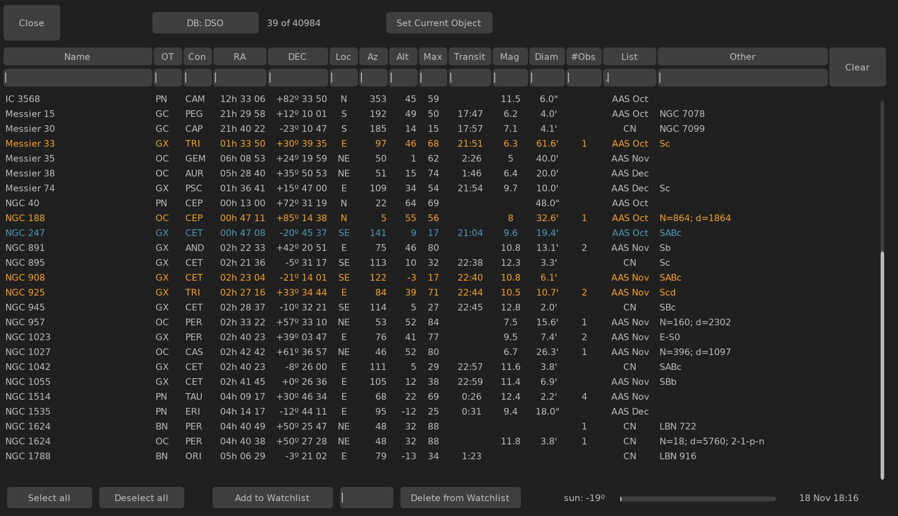
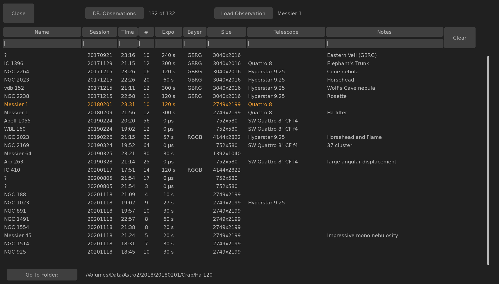
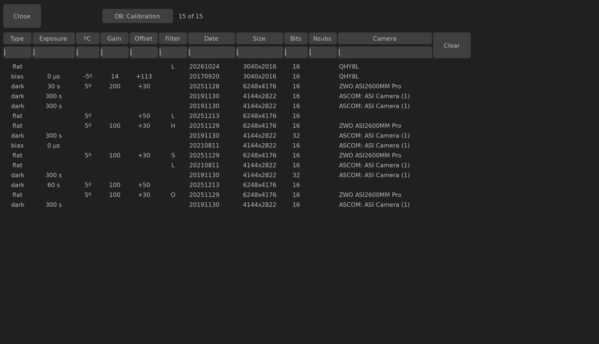
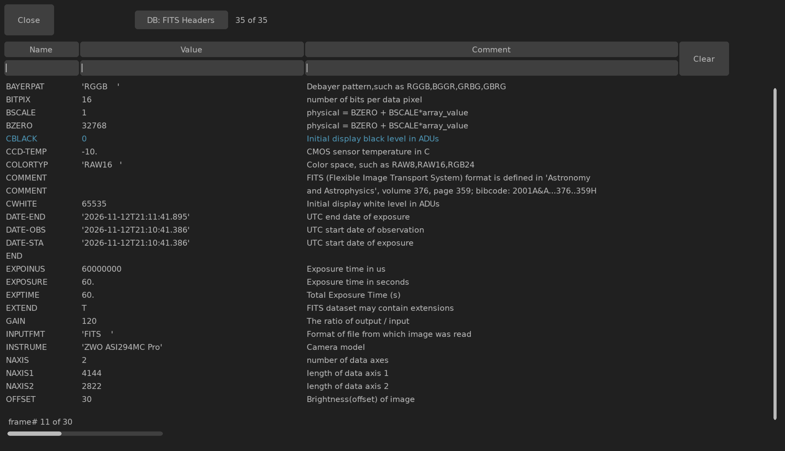

# Databases

##Overview

Lövell maintains a number of databases to support its functionality:

  * DSOs
  * Observations
  * Calibration files 
  * Telescopes
  * Cameras
  * FITS files headers

All databases are displayed in the form of spreadsheets, with column titles, column search filter boxes and, if required, a scrollbar.  A 'Clear' button to the right hand side of these two header rows clears them to their reset values.  A 'Close' button in the top left of the screen returns to the main display (also activated by typing the ESC key.)  The button to the right of the 'Close' button, with the database name followed by an ellipsis (...) is a drop-down menu to access the other databases.  Other controls may be scattered around the top and bottom margins to implement database-specific actions.

Clicking a column title button sorts the rows in a forward/reverse direction.

The search filters are of two main types: numeric and plain text, depending on the data shown in that column.

Text filters are case-insensitive and allow the '.' and '*' wildcard characters for a single character or any number of characters, respectively.

Numeric filters can be simply a number, in which case an exact match is required.  Additionally, an inequality  '<' or '>' may precede a numeric value to allow a search for values below or above a given threshold.

A right-click (or two-fingered click for touch input devices) clears the individual text box.

The usual line (de)selection methods are available by clicking on individual lines, shift-clicking to define a contiguous set of rows, or command-clicking to select discrete rows.

## DSOs

The DSO database provides a number of functionalities.  At the basic level it contains some 40,000 objects of interest, with common identification features: name, object type, constellation, RA and DEC coordinates, magnitude and diameter.  Additionally, some dynamic parameters are computed in real time: azimuth, altitude, maximum altitude, transit time, and location (which is a convenient octant-based indication of azimuth: N, NE, E, ...).  

Selecting a single object and then the 'Set Current Object' button is one way to add the object details to the current observation.

A further feature is provision for observing watchlists.  The number of recorded observations are displayed as well as the name of an observing list.  To add an object, or multiple objects, select them in the usual spreadsheet way and then click 'Add to Watchlist'.  Alternatively, remove them with the 'Remove from Watchlist' button.  By default, following the Jocular modality, the watchlist is titled by today's date (eg. 25 Dec), but the text input box between the two watchlist buttons may be used to define any short list name.  So it's possible to name any number of watchlists simultaneously, and you can move objects betwen lists by simply renaming them to the new list.  An object can, of course, only be on one list at once.  The search box for the 'List' column makes it especially easy to work through a list of targets.

The final function of this database is to provide an observation planner.  The combination of watchlists, dynamic parameters of azimuth and elevation (and octant) and column filters, allow you to plan and organise a viewing session.  For example, you could select the objects on a particular watchlist which are above 45 degrees elevation, in an easterly direction, and ordered in transit time, making it very easy to pick them off one by one with a minimum of mount movement.  One powerful extra tool here is the horizontal slider which allows up to 24 hours to be added to the current time, so that you can plan in advance of an evening's session where the targets will be at the time you plan to observe.  The dynamic parameters are instantly recomputed for the set time, and also the elevation of the sun.  A right-click on this slider resets its value to zero, hence back the current time.

!!! tip
    As a bonus 'Easter egg', double-clicking on an object which has at least one recorded observation will take you to the Observations database showing just those observations...

!!! note
    If you've used Jocular, then this should seem very familiar, because 95% of the implementation code has been ported directly from there, with just a few tiny additional enhancements.

## Observations 

A list of previous observations.  It includes the session number (date in YYYMMDD format) and local time, number of exposures and average exposure, Bayer pattern (if an OSC camera with a CFA) and image size, name of the telescope, if known, and any observation notes you may have added.

Filtering and sorting of columns works as standard (ie. as for the DSOs).  Selecting an observation row allows you to load that data using the 'Load Observation' button, or visit its folder of raw subs on disk with the 'Go To Folder' button.

!!! tip
    Double clicking on a row instantly starts loading that observation in the same way as the 'Load Observation' button.

## Calibration files

Bias, Darks, and Flats to be applied in the calibration of incoming images.

!!! warning
    The handling of calibration master files is under review/development.  The screen may not look exactly like this.
    
## FITS file headers

Unlike the other databases, this is not persistent between sessions, but is build dynamically from the file headers of incoming images for the current observation.  Depending on the acquisition software being used, this may have details of the image format, filters, cameras, mount positioning, temperature, and other parameters.  If present, some of the key values are extracted and stored in the observations database.

!!! tip
    This example has been sorted by the 'Name' field, which makes it much easier to find a given parameter.
    
The header data from every sub in the observation is available to view here, you can just scroll through the frames with the horizontal slider.
