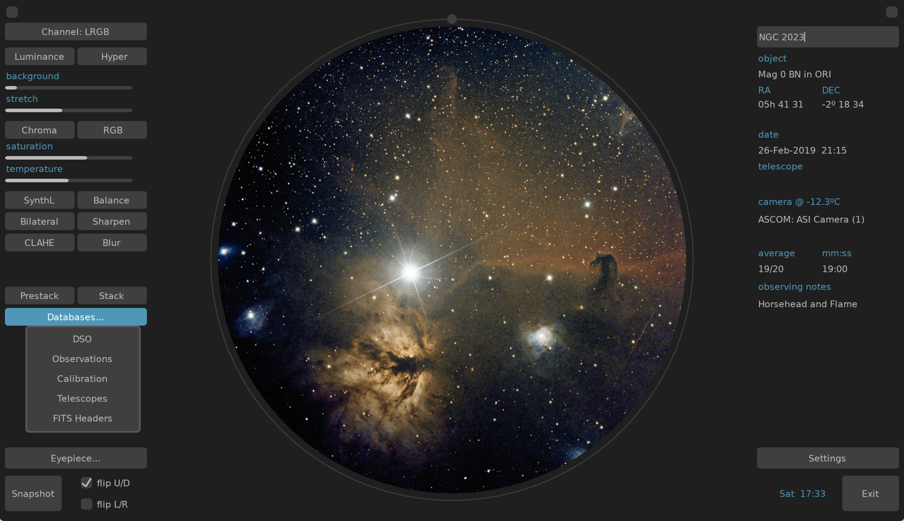
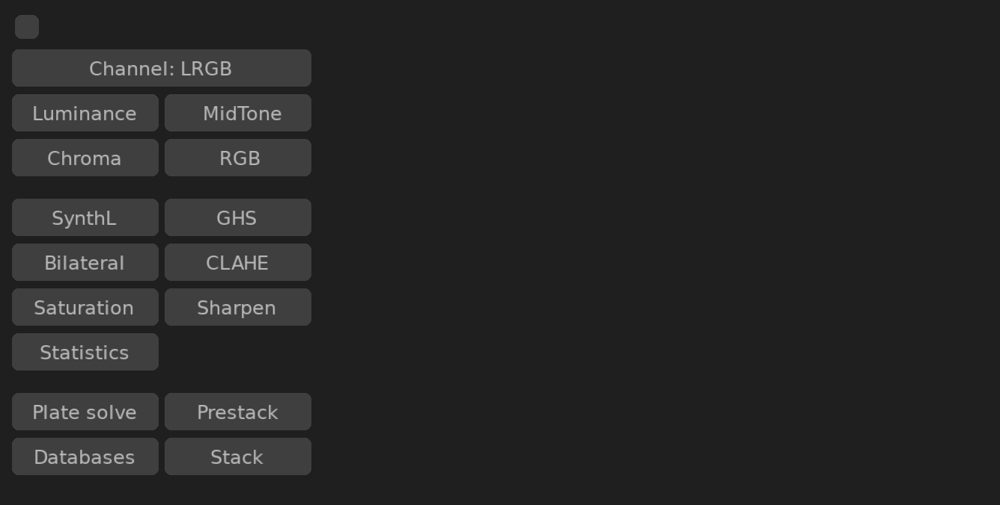
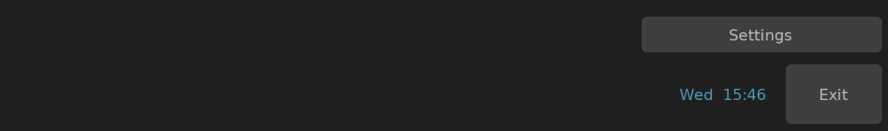

#The Main Display

The main display shows a stacked image with controls for adjustments and an information panel.  
    

##Image area

The central image area has two formats.  By default an eyepiece view is shown, a circular window onto generally the central portion of the image.  Alternatively, a rectangular (landscape) view of the image can be chosen.  The eyepiece view ('ocular') is stolen from Jocular for good reasons: it serves to focus the attention on the object of interest; it hides the corners of the image where optical abberations such as vignetting and coma are prevalent;  it allows manual rotation of the image by clicking and dragging the border which is highlighted when hovered; and it evokes a 'through the telescope' or possibly 'spaceship porthole' aesthetic.

The control panel button in the lower left shows the current mode 'Eyepiece...' or 'Landscape...' and may be toggled by clicking on it.  Either view may be moved by clicking and dragging on the central part of the image.  The zoom level may be changed with a scroll gesture (mouse wheel / two-fingered drag on a touch pad).

The checkboxes in the same left-hand corner may be used to flip the image vertically or horizontally to get a preferred view.

!!! tip
    There are also keyboard shortcuts to change the view: 
    
    **Command-E** is Eyepiece, **Command-L** Landscape, and **Command-T** toggles between them.
    
    **Command-'-'** and **Command-'+'** zoom out and in.
    
    **Command-'/'** and **Command-'\'** rotate clockwise and anti-clockwise.
    
    For a full list of keyboard shortcuts see that section in the documentation.

##Control Panel

The control panel on the left hand side is mostly populated by buttons which display menus when clicked or hovered.  Many of these controls are plugins, which provide parameter adjustments for various different processing steps.  Some of them are permanently in place (static), others (dynamic) may be configured, moved around, or removed completely and replaced by others, through a separate [Plugin Workflow editor page](workflow.md).

Additionally, many of the plugin menus have a checkbox which splits the controls between those which are retained in the drop-down and others which are moved to appead below the button and are visible and accessible all the time. This flexibility means that the order of the menu buttons, and the screen appearance, may vary depending on their configuration.  However, there are four main functional areas:

static 
  

  
### 1. Channel, Luminance/Midtone, Chroma/RGB

This group largely controls how the final stacked and processed image is rendered.  The **Channel** menu with **LRGB** as a default shows a full colour image (if any).  Other options show just the luminance or individual Red / Green / Blue channels, and also a photographic 'negative' view of the luminance – sometimes helpful in detecting low contrast features in some targets.

**Midtone** is one of several stretch functions MidTone / Asinh / Hyper / Linear / Log / Gamma / ... which may be selected from that menu.  **RGB** is one of several chroma processing modes.

The **Luminance** menu drops down to show gradient / vignette / white point sliders plus the main controls of background level and stretch amount.

The **Chroma** show controls for tint / SCNR (green) and the main controls of colour saturation and temperature for the RGB option.  Other chroma modes (HSO) have their own different controls.

!!!tip
    The Luminance and Chroma menus may be 'split' using the checkboxes halfway down each menu.  This keeps the major controls showing in the panel beneath their respective buttons, even if their menus are not hovered.
    
!!! tip
    Double-clicking on the image itself also toggles the normal/inverted mode.

### 2. Post-stack processing

The next group shows a series of post-processing options, implemented by dynamic plugins.  These are selected with the [Plugin workflow editor](workflow.md)  page, where the sequence and type of post-stack processing can be configured.  This section, then, may have a difference appearance from that imaged.

This group begins with the **SynthL** plugin which is the first step in the post-stack workflow, constructing a synthetic luminance from separate RGB (and/or HSO) and L stacks, which may then be applied to whatever chroma processing has been selected.  In general, however, the following plugins include steps to smooth, sharpen, and refine the image.  Such options as Bilateral filtering, sharpening,  contrast enhancement may be configured.  Other plugins include additional colour saturation processing and statistical parameters from the stack.

### 3. Pre-stack and stacking

**Prestack / Stack** menus give options for those stages of processing.

**Databases** gives access to various catalogs, etc.

### 4. Display format

Button to toggle between Eyepiece and Landscape layouts.

Checkboxes to flip image in either axis.

**Snapshot** button, see [Snapshots](snapshots.md).

!!! note
    The flip checkbox settings are over-ridden by the Platesolve plugin, along with the image rotation, in order to correctly orient the image as North-up / East-left.

##Information Panel

Input field to name the object.

Other useful info

### Panel Controls

A small cluster of controls at the lower right-hand corner of the screen provides a button to switch to the [Settings](settings.md) page, a button to **Exit** the application, and a label showing the current day and local time (so you don't stay up too late observing).

!!! tip
    Command-Q will also close Lövell, and on Mac OS command-W (close window) too.
    
    Command-M, on a Mac, will minimise the window to the dock.
    
