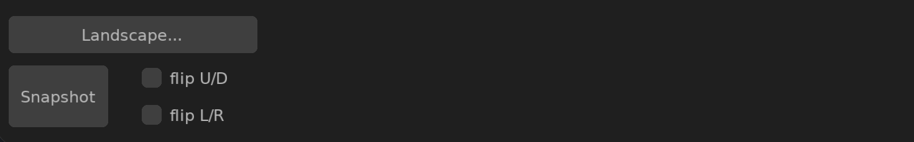

#The Main Display

The main display shows a stacked image with controls for adjustments and an information panel.  
    

##Image area

The central image area has two formats.  By default an eyepiece view is shown, a circular window onto generally the central portion of the image.  Alternatively, a rectangular (landscape) view of the image can be chosen.  The eyepiece view ('Ocular') is stolen from Jocular for good reasons: it serves to focus the attention on the object of interest; it hides the corners of the image where optical abberations such as vignetting and coma are prevalent;  it allows manual rotation of the image by clicking and dragging the border which is highlighted when hovered; and it evokes a 'through the telescope' or possibly 'spaceship porthole' aesthetic.

The control panel button in the lower left shows the current mode 'Eyepiece...' or 'Landscape...' and may be toggled by clicking on it.  Either view may be moved by clicking and dragging on the central part of the image.  The zoom level may be changed with a scroll gesture (mouse wheel / two-fingered drag on a touch pad).

The checkboxes in the same left-hand corner may be used to flip the image vertically or horizontally to get a preferred view.

!!! tip
    There are also keyboard shortcuts to change the view: 
    
    **Command-E** is Eyepiece, **Command-L** Landscape, and **Command-T** toggles between them.
    
    **Command-'-'** and **Command-'+'** zoom out and in.
    
    **Command-'/'** and **Command-'\'** rotate clockwise and anti-clockwise.
    
    For a full list of keyboard shortcuts see that section in the documentation.

##Control Panel

The control panel on the left hand side is mostly populated by buttons which display menus when clicked or hovered.  Many of these controls are plugins, which provide parameter adjustments for various different processing steps.  Some of them are permanently in place (static), others (dynamic) may be configured, moved around, or removed completely and replaced by others, through a separate [Plugin Workflow editor page](plugins.md#Workflow Editor).

Additionally, many of the plugin menus have a checkbox which splits the controls between those which are retained in the drop-down and others which are moved to appead below the button and are visible and accessible all the time. This flexibility means that the order of the menu buttons, and the screen appearance, may vary depending on their configuration.  However, there are four main functional areas:

static 
  

  
  
* **Channel: LRGB** menu views LRGB / Mono / Inverted / Red / Green / Blue channels individually
* **Hyper** is one of several stretch functions MidTone / Asinh / Hyper / Linear / Log / Gamma / ...
* **Luminance** menu drops down to show additional gradient / vignette / white point sliders
* **background / stretch** are the main luminance controls (right- or shift- click set to default)
* **RGB*** menu also includes Hubble (SHO) and possibly other colour processing options
* **Chroma** menu drops down to show additional tint / SCNR (green) sliders
* **saturation / temperature** are the main chrominance controls for the RGB option
* **SynthL / Balance / Bilateral / Sharpen / CLAHE / etc.**  are controls for optional processing plugins
* **Prestack / Stack** menus give options for those stages of processing
* **Databases** (shown dropped down) gives access to various catalogs, etc.

##Information Panel
