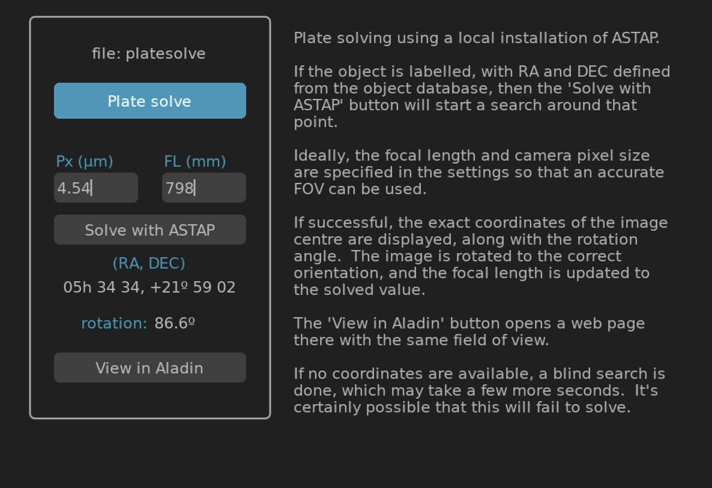

# Plate Solving

Plate solving is the action of locating the exact coordinates (such as right ascension and declination) of an astronomical image, by matching it to known star locations.  Additionaly, the image scale, and camera orientation may be solved.  Given a camera with known pixel size, the exact focal length of the optical system may be determined.  This is often done as a prelude to annotating the image with known deep space object identifiers.

In Lövell, plate solving is achieved through an external program called ASTAP, which has to be installed separately.

##ASTAP Installation

Installers for all the major operating systems and machine architectures are available here [https://www.hnsky.org/astap.htm](https://www.hnsky.org/astap.htm).  Select the appropriate one for your system.

Additionally it requires a star database to be downloaded, also available at that site.  There's several to choose from depending on your equipment and needs.  I used the D20 one.

##Platesolve plugin

The platesolve plugin is static (permanently installed).

