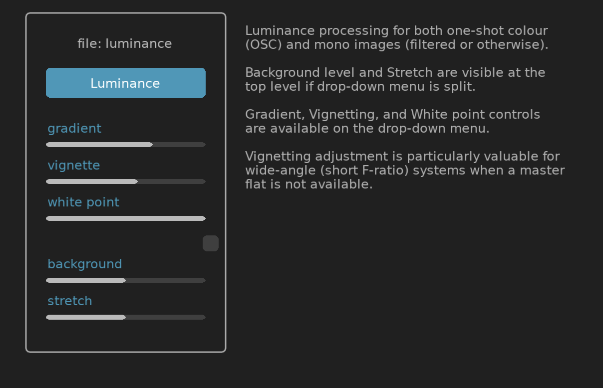
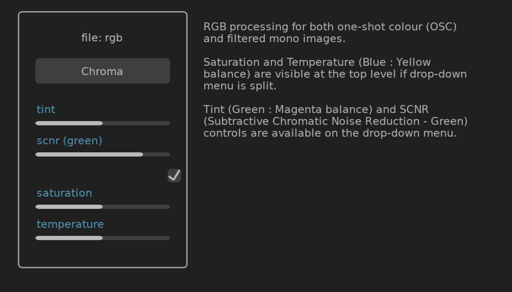
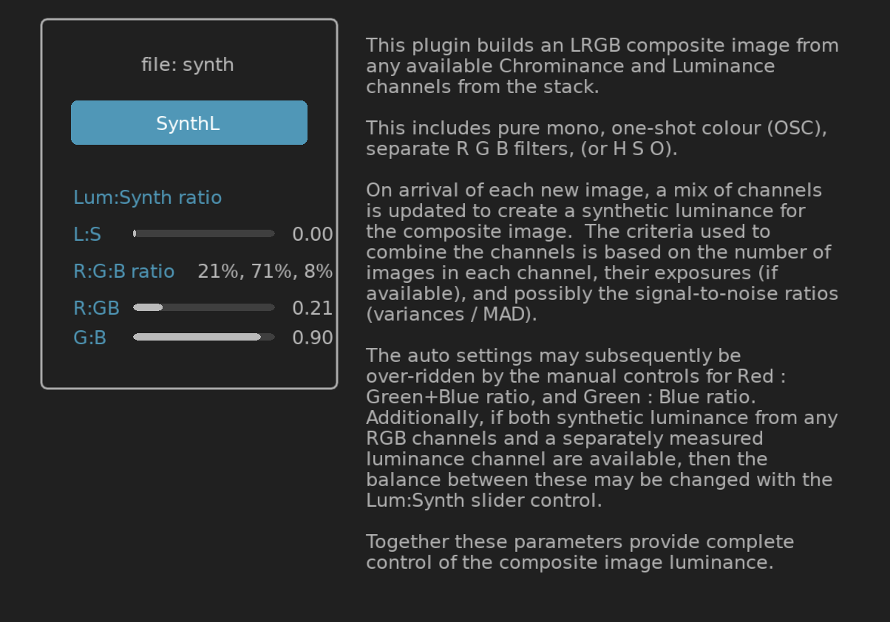
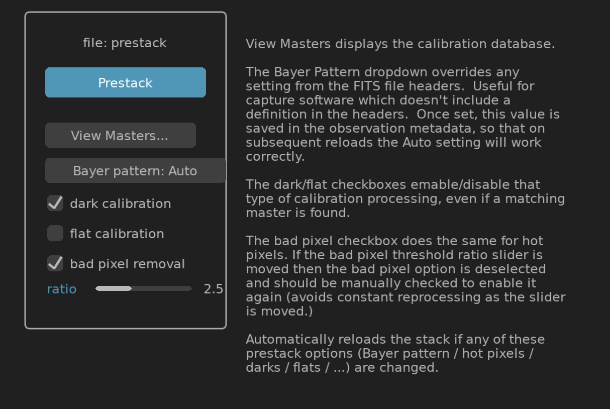
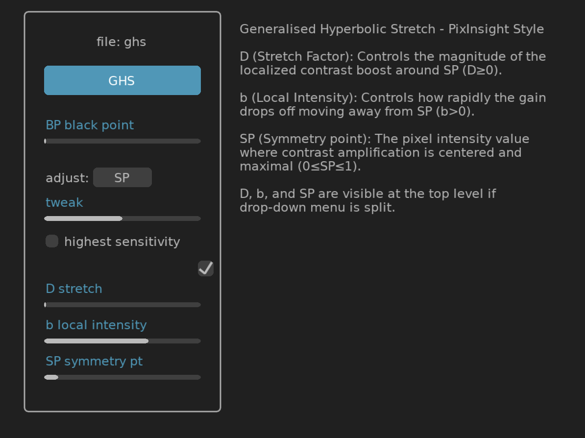
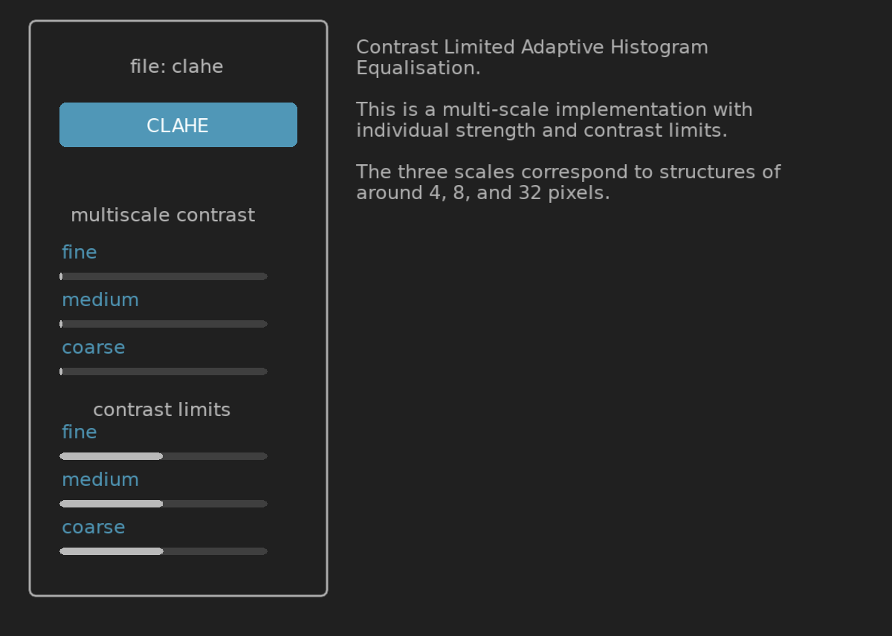
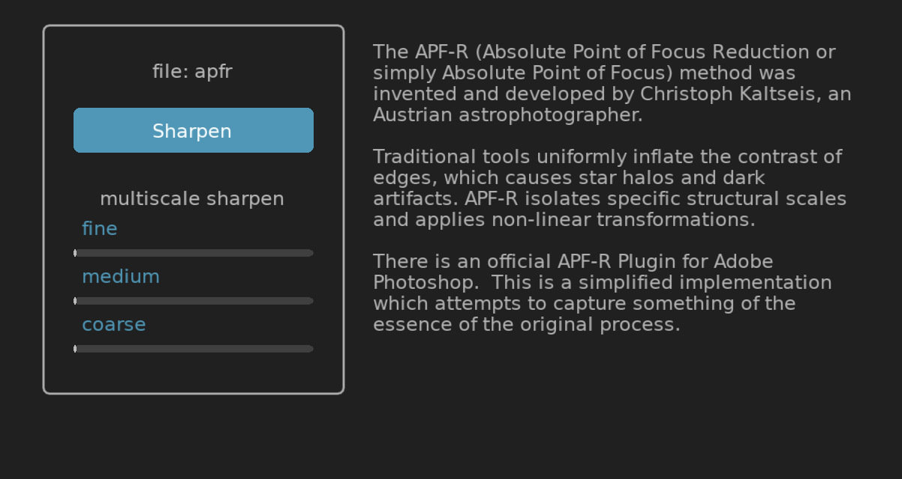

#Plugins

Much of Lövell's functionality is implemented as separate processing modules called plugins.  There are of two types: Static or Dynamic.  There is a separate [Plugin workflow editor](workflow.md) page, which allows dynamic plugins to be (de)selected and placed in order into the post-stack workflow, appearing as dropdown menus on the main display page.

!!! note

    The modular plugin architecture allows for (relatively) easy processing extensions to be added to Lövell.  Each plugin is a classic MVC (model-view-control) structure containing its own controls, GUI, processing (probably implemented as a GLSL shader plus Lua code), and brief documentation.

##Workflow Editor

## Static Plugins

Static plugins are part of the system workflow and, as such, are permanently installed 

###Luminance

###Chroma

####RGB

####Hubble

HUBBLE (pseudo-SHO) based on Bill Blanshan's "Narrowband Normalization" PixInsight code.

This treats RGB channels as HSO and swizzles them to be SHO ordered.

The controls are specfic to his process and more details can be found online, but feel free to experiment, the names are fairly self-explanatory.

###Synthetic Luminance

###Prestack

##Dynamic Plugins

Dynamic plugins may be picked to appear in the post-stack workflow processing chain.  Simply drag and drop into a blank location in the post-processing chain column.  Valid locations are highlighted as you drag.  To remove a plugin from the processing workflow, simply drag and drop it away from the workflow column and it will snap back to its reserved location in the plugin list.

###Generalised Hyperbolic Stretch (GHS)

An altogether better way of stretching images.

This stretch is applied after any of the built-in stretches.

###Contrast Limited Adaptive Histogram Enhancement (CLAHE)

Another way to effectively sharpen an image by increasing its contrast in different areas,

###Sharpen

Sharpening method based on the ideas of APF-R

