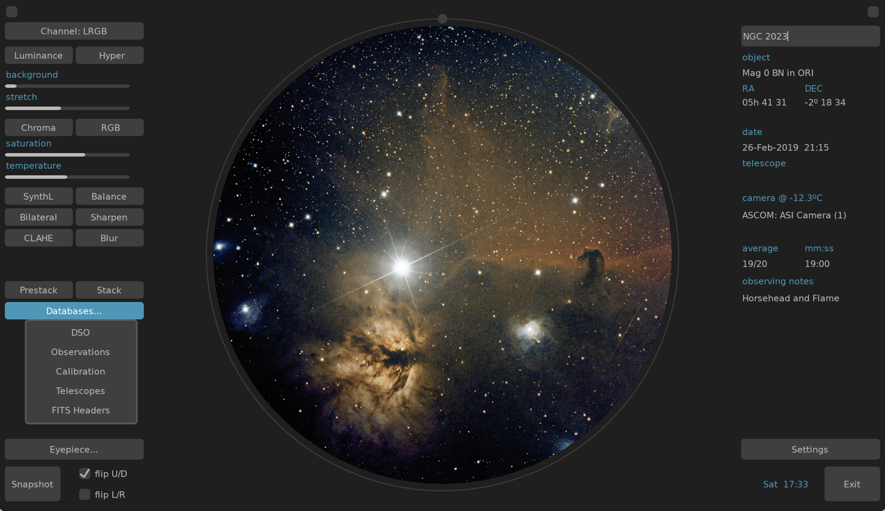
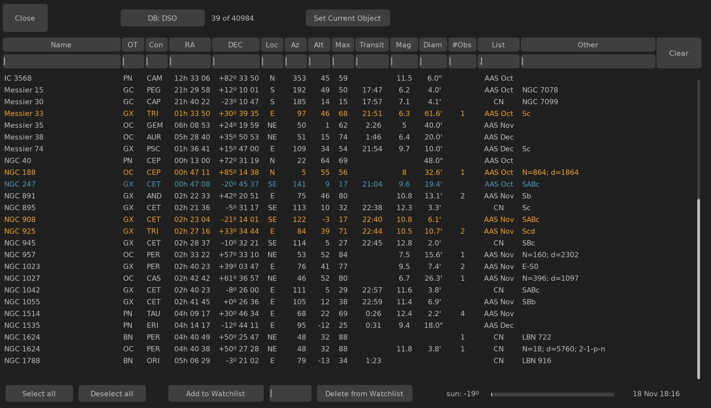
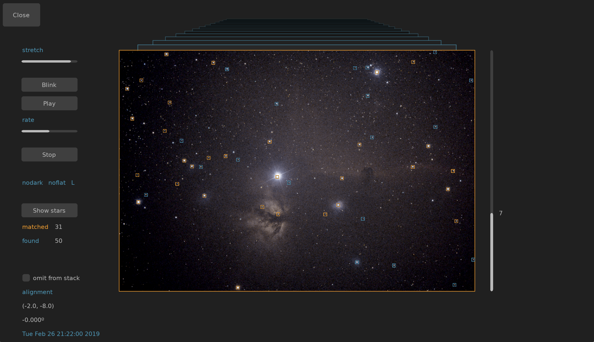

#Quick Tour

* click on the Lövell.love file (or drop onto the LÖVE app) to run it
* drop a folder containing raw 16-bit FITS files onto the app window...
* ...the folder is continuously watched for new FITS files appearing.

## Main display

The main display shows a stacked image with controls for adjustments and an information panel.  Most buttons are drop-down menus (which remain pinned if clicked rather than hovered.)

* **Channel: LRGB** menu views LRGB / Mono / Inverted / Red / Green / Blue channels individually
* **Hyper** is one of several stretch functions MidTone / Asinh / Hyper / Linear / Log / Gamma / ...
* **Luminance** menu drops down to show additional gradient / vignette / white point sliders
* **background / stretch** are the main luminance controls (right- or shift- click set to default)
* **RGB*** menu also includes Hubble (SHO) and possibly other colour processing options
* **Chroma** menu drops down to show additional tint / SCNR (green) sliders
* **saturation / temperature** are the main chrominance controls for the RGB option
* **SynthL / Balance / Bilateral / Sharpen / CLAHE / etc.**  are controls for optional processing plugins
* **Prestack / Stack** menus give options for those stages of processing
* **Databases** (shown dropped down) gives access to various catalogs, etc.
* mouse wheel / trackpad scroll zooms the display
* click and drag moves the display
* click on **Eyepiece..** to switch to **Landscape..** display, and *vice versa*
* hover over eyepiece ring to activate image rotation, click and drag to change
* enter object name in field on top right to search DSO catalogue

## DSO / Observation list

Some 40,000 objects of interest.
Close button returns to main display.  

* click on column names to sort
* text or numeric expressions in filter boxes to select subsets
* click, shift-click, option/control-click to (de)select multiple items
* right click on image to show pop-up menu of **DSO / Observations / Watch list / View stack**
* scroll control to forward time by up to 24 hours, updating object positions in Az, Alt, etc...

## View stack/subs

View all the subs in sequence, show detected and matched stars.
Close button returns to main display.  

* mouse wheel / trackpad to scroll through subs
* **Stretch** applies a variable screen stretch to the display
* **Play** button animates sequence of subs
* **rate** control changes speed
* **Blink** toggles between adjacent subs
* **Show stars** indicates detected stars (in blue) and those matched for alignment (orange)
