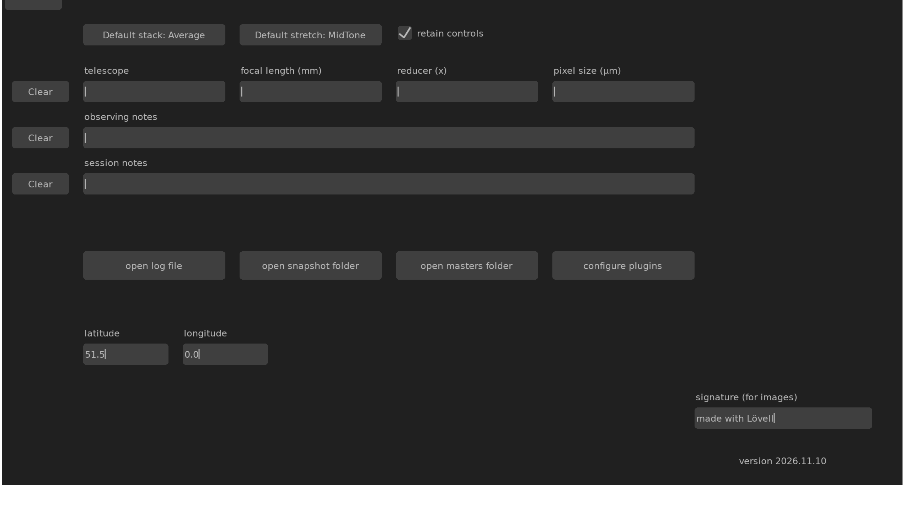

# Settings

The Settings page provides a useful home for a number of les-used input fields and buttons.

##Defaults

The first button row provides a way to define your preference for the startup values of the Stack and Stretch menus, and also a checkbox which retains all plugin control settings between different observations (but not between separate sessions).  Otherwise they are reset to their default initial values for each observation.

##Optical system

Some details of the optical system are settable here.  Most decent acquisition software will define the camera pixel size in the FITS headers, but may not include the focal length which is a key parameter in plate solving.

!!! note
    If the pixel size is not defined, plate solving will not be able to determine the correct image scale.  If focal length is missing, or wrong, plate solving (ASTAP) may attempt a number of different scales and can still correctly solve the image.  For all successful solves, the focal length is changed to the solved value and stored in the observation metadata so that it is correct when next loaded.

## Observation and Session notes

Short observations notes are shown on the information panel on the main display, and cleared between observations.  The may also be shown in some snapshot format.

Short sessions notes are retained for the whole session over multiple observations and, again, shown on the main display page.

!!! tip
    Ech of the above items has a **Clear** button to delete all the input, but this may also be achieved by right-clicking the input box (two-fingered click for touch in put devices).
    
## Navigation buttons

The **open log file** button uses the system's document browser to access the file which is opened in a separate window.  The file is located in the Lövell's SAVE directory (see [Installation](installation.md))

The **open snapshot folder** button provides a fast way to access previous screen snapshots stored in Lövell's SAVE directory in the **snapshots** folder.  It opens with the system file browser in a separate window.

The **open masters folder** similarly opens the calibration master files folder in the SAVE directory.

The **configure plugins** button is an insternal link to the [Plugin Workflow Editor](workflows.md) page.

!!! tip
    The workflow editor may also be accessed with the keyboard shortcut **command-P**.

##Location coordinates

Latitude and longitude (negative for west of the meridian) may be entered here.  It's essential to do this so the DSO database to show the correct RA and DEC coordinates.  

!!! note
    Currnet local time is taken from your system's settings.

##Signature for Snapshots

Annotated snapshots include a line for a 'signature'.  The text is adjustable here and saved between sessions.

!!! note
    The application version is also shown on this page.  Maybe useful if you need to report an issue.
    
