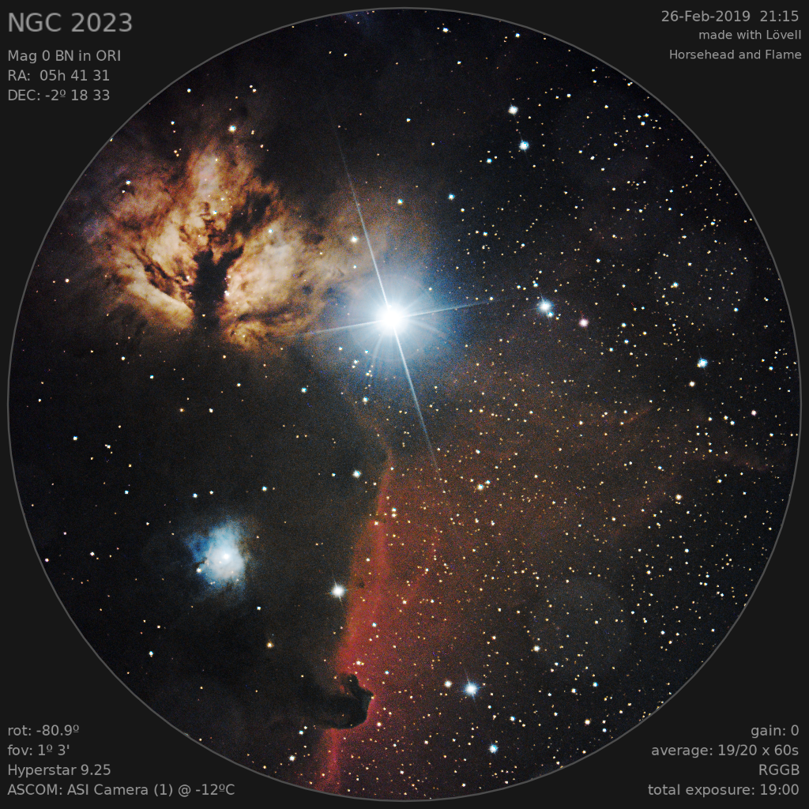
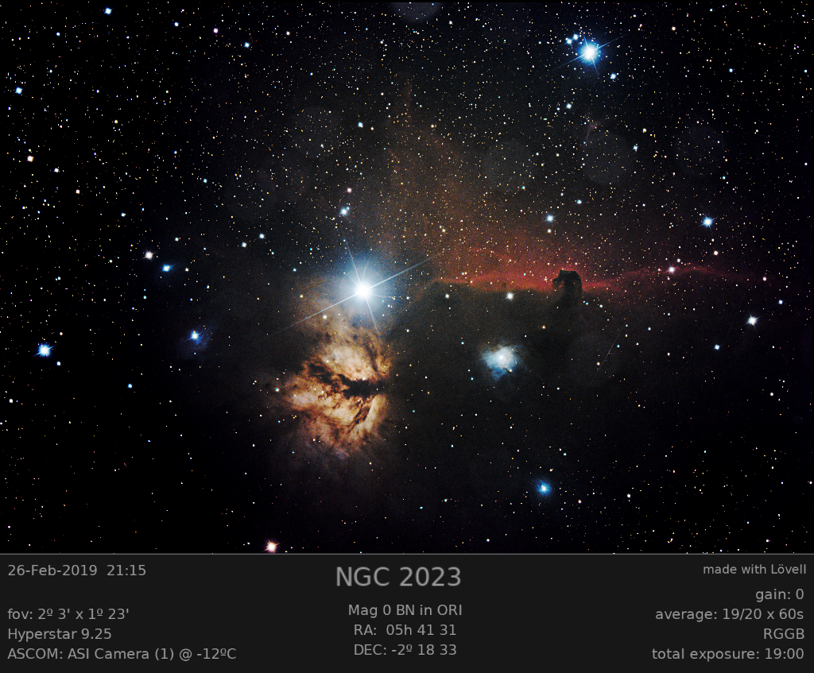
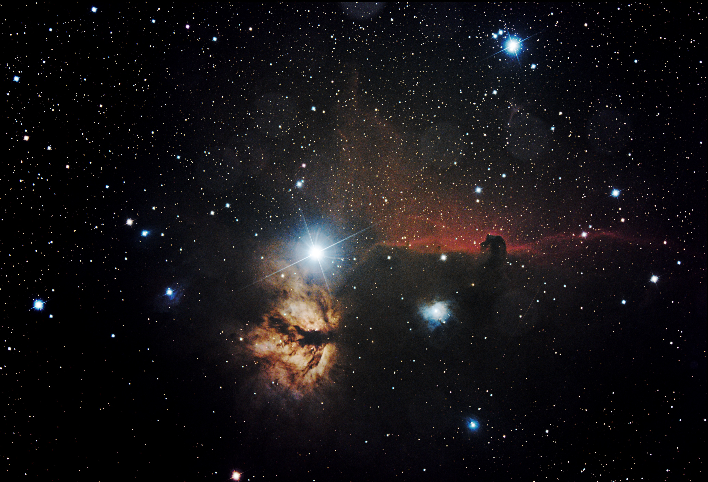

#Snapshots

The **Snapshot** button on the lower left of the main display screen captures a PNG image of the current object and saves it in the **snapshots** folder in Lövell's SAVE directory (easily accessed through the Settings page).

Three different styles of capture are available:

  1. Eyepiece, with annotation
  2. Landscape, with annotation
  3. Full Resolution, unannotated
  
The style used for 1 & 2 matches the current viewing mode.  To get option 3, hold the **Option** key down before pressing **Snapshot** in either display mode.  The button annotation will change to **Large PNG** whilst the option button remains pressed.

The Eyepiece snapshot mirrors the look on the display, retaining its translation, flip, zoom, and rotation settings.  The Landscape mode always shows the full extent of the stacked image (including any ragged margins which may arise from target tracking between frames) without rotation or zoom (but the vertical and horizontal flips are applied), as does the full-resolution capture.

!!! tip
    These captures are all PNG files, since that is the only common format which LÖVE currently supports.  The full resolution can be quite large (~50 Mbyte), but it's easy to reformat them with the usual system utilities.  (I could generate a JPG by spawning an external process, but that's system-dependent and I haven't seen the need, yet.)
    
##Eyepiece (oriented)

##Landscape

##Full Resolution

!!! note

    Just for fun (another 'Easter Egg') the snapshot action has a shutter sound effect.