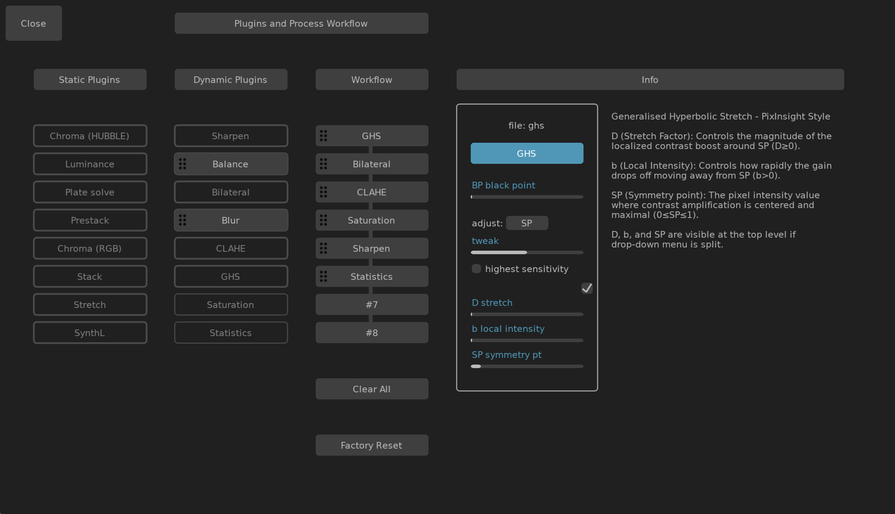

#Process Workflow Editor

The Plugin workflow editor page (command-P) allows dynamic plugins to be (de)selected and placed in order into the post-stack workflow, appearing as dropdown menus on the main display page.

!!! note

    The modular plugin architecture allows for (relatively) easy processing extensions to be added to Lövell.  Each plugin is a classic MVC (model-view-control) structure containing its own controls, GUI, processing (probably implemented as a GLSL shader plus Lua code), and brief documentation.

This page is divided into four column areas:

  * Static plugins
  * Dynamic plugins
  * Processing workflow
  * Information area
  

##Static Plugins

Static plugins are permanently installed parts of the processing chain and provide the basic elements of prestack and stacking workflow.  

Hovering over a plugin will show its menu layout and some textual help in the information area.

##Dynamic Plugins

Dynamic plugins are all configurable steps in the post-stack workflow.  The may be drag and dropped onto empty positions in the workflow chain.  As soon as you start dragging a plugin, all possible (empty) destinations in the chain are highlighted.  Dropping the plugin on one of these locations enables its processing at that point in the workflow.  Dropping elsewhere allows the plugin to snap back into its home position, removing it from the chain.

##Processing Workflow

This chain of plugin processes defines the post-stack workflow.  It is performed in order, top to bottom, with empty steps being ignored.  The order is also used in the main display to arrange the menu button in two columns of the control panel.

Below the main chain, the **Clear All** button will remove all configured plugins from the processing chain so that you can start afresh.  The **Factory Reset** button returned to the initial default configuration.

The workflow is retained between separate Lövell runs.
##Information Area

This shows the menu layout of the selected plugin, and also its display name and filename.  The static and dynamic columns are sorted by filename, which is unique between plugins, whereas the plugin display name (ID) is not unique.  This is because plugins can provide alternative implementations of the same post-stack processing step.  CHROMA is one such class of plugins, with RGB and HSO (and possibly others) being options.

Some help text for the controls is shows to the right of the menu layout.  All plugin menus may be pinned with a checkbox in the top right-hand corner of the menu, so that they remain displayed even when not hovered.  Some menus have an additional checkbox between two groups of controls.  Checking this splits out from the menu the items below it, to appear permanently in the main display control panel beneath the plugin button.  This is to allow the major (frequently used) controls to remain visible at all times, for easy access.

!!! note

    Due to the configurability of the workflow, the main display will, inevitably, change appearance, so some screen shots in this documentation may not exactly match what you see.
    
